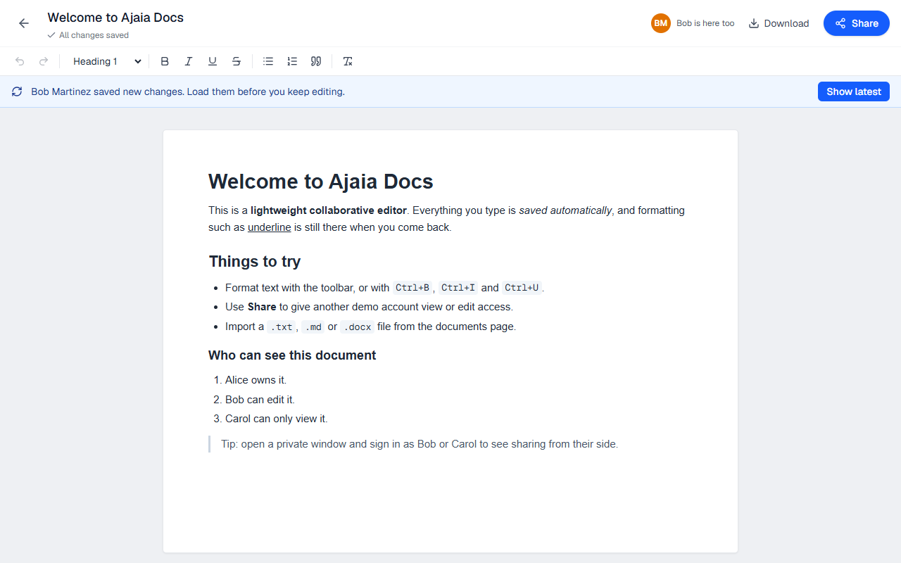

# Ajaia Docs

A lightweight collaborative document editor: create and format documents in the browser, import files, and share them with other people as editors or viewers.

**Live demo:** https://ajaia-collab-docs-one.vercel.app

Built for the Ajaia AI-native full stack assessment. See [ARCHITECTURE.md](ARCHITECTURE.md) for what I prioritized and why, [AI_WORKFLOW.md](AI_WORKFLOW.md) for how AI was used, and [SUBMISSION.md](SUBMISSION.md) for the full list of deliverables.



More screenshots are in [`docs/screenshots/`](docs/screenshots): sign-in, documents, editor, share dialog, read-only viewer and phone layout.

## Demo accounts

Sign-in is simulated: open the app, pick an account, no password needed. To see sharing from both sides at once, sign in as a second account in a private window.

| Account | Email | What it shows |
|---|---|---|
| Alice Johnson | alice@example.com | Owns "Welcome to Ajaia Docs" (shared with Bob and Carol) and a private "Q1 launch plan" |
| Bob Martinez | bob@example.com | Can **edit** Alice's welcome doc; owns "Team retro notes", shared with Alice as view-only |
| Carol Chen | carol@example.com | Can only **view** Alice's welcome doc |

## What works

- **Documents:** create, rename (click the title), delete (owner only), and reopen. The home page separates **My documents** from **Shared with me** and shows owner and access level.
- **Rich-text editing** (Tiptap): bold, italic, underline, strikethrough, headings 1 to 3, bulleted and numbered lists, quotes, undo/redo and clear formatting, from the toolbar or keyboard shortcuts.
- **Autosave:** changes save about a second after you stop typing (or straight away with `Ctrl+S`), with a visible status: *Saving… / All changes saved / Couldn't save, retrying*. If you leave the page with unsaved edits, they're sent before it closes.
- **Overwrite protection:** every save carries the version it was based on. If someone else saved in between, the save is rejected (HTTP 409) and you're asked to reload, instead of their work being silently overwritten.
- **Sharing:** the owner shares by email as **Can edit** or **Can view**, changes roles and removes access. Viewers get a read-only editor, and the API rejects their writes too.
- **File import:** upload a file to turn it into a new editable document. Headings, bold, italic, underline and lists are kept.
- **Persistence:** documents, formatting and sharing live in Postgres and survive refreshes and redeploys.

**Stretch features**, added once the above was done and verified:

- **Presence and live updates:** the editor header shows who else has the document open ("Bob is here too"). When someone saves, others see *"Bob Martinez saved new changes · Show latest"* within about 10 seconds, instead of finding out later through a conflict. Viewers' read-only copies update on their own.
- **Export:** *Download → Markdown (.md)*, or *PDF* through the browser's print dialog. A print stylesheet hides the app's toolbars and banners, so only the document is printed.

### Supported import formats

| Format | Notes |
|---|---|
| `.txt` | UTF-8 text. Blank lines become paragraphs. |
| `.md` / `.markdown` | Headings, emphasis, lists, quotes, code and links. |
| `.docx` | Converted with mammoth. Images and complex layout (tables, columns) aren't imported. |

Files up to **2 MB**. Anything else (PDF, images, `.doc`) is rejected with a clear message, both in the browser and on the server.

## Run it locally

**You need:** Node.js 20.9 or newer (tested on 22), and a Postgres database. A free [Neon](https://neon.tech) database works, as does a local Postgres 14+.

```bash
npm install
cp .env.example .env.local        # Windows PowerShell: Copy-Item .env.example .env.local
```

Open `.env.local` and set:

- `DATABASE_URL`: your Postgres connection string
- `SESSION_SECRET`: any random string of 32+ characters (`.env.example` shows how to generate one)

Then create the tables and demo data, and start the app:

```bash
npm run db:setup    # runs migrations, then seeds the demo accounts and documents
npm run dev         # http://localhost:3000
```

`npm run db:seed` is safe to run again: it won't create duplicates.

### Scripts

| Script | What it does |
|---|---|
| `npm run dev` | Start the dev server |
| `npm run build` / `npm start` | Production build / serve it |
| `npm test` | Run the Vitest suite |
| `npm run smoke [-- URL]` | End-to-end API checks against a running app |
| `npm run typecheck` | TypeScript check |
| `npm run db:generate` | Create a migration after changing `src/lib/db/schema.ts` |
| `npm run db:migrate` | Apply migrations |
| `npm run db:seed` | Create demo accounts and documents |
| `npm run db:setup` | `db:migrate` then `db:seed` |
| `npm run db:reset-demo` | Delete and recreate the demo accounts' documents |

## Tests

There are two layers:

```bash
npm test                    # 53 unit tests, no database needed
npm run smoke               # 40 end-to-end checks over HTTP against a running app (http://localhost:3000)
npm run smoke -- https://ajaia-collab-docs-one.vercel.app   # the same checks against the live deployment
```

**Unit tests (Vitest)** cover the parts where a bug would hurt most:

- **Access rules:** the full owner/editor/viewer permission matrix, plus *404, not 403* for documents that aren't shared with you.
- **Import pipeline:** `.txt`, `.md` and a real `.docx` (generated in memory) converted with formatting intact; scripts, event handlers and `javascript:` links stripped; wrong type, oversized, empty, non-UTF-8 and corrupted files rejected with the right status codes.
- **Validation and sanitizing:** share and update payloads, and sanitizing of editor saves.
- **Export:** HTML to Markdown, including a round trip back through the importer.

**The smoke test** (`scripts/smoke.ts`) signs in as the three demo accounts and drives the real API. It covers:

- creating, saving and reopening with formatting intact, and the 409 on a stale save
- every role's allowed and forbidden actions, sharing, role changes and access removal
- presence and new-version notices
- HTML sanitizing and file import

It deletes everything it creates.

After manual testing, `npm run db:reset-demo` puts the demo documents back to their original state.

## Deploying

The live demo runs on **Vercel** (free Hobby plan) with **Neon Postgres** (free plan):

1. Create a Neon project and copy its pooled connection string.
2. Import the GitHub repo in Vercel and add two environment variables: `DATABASE_URL` and `SESSION_SECRET`. No build settings need changing.
3. Run `npm run db:setup` once against that database, with its `DATABASE_URL` in `.env.local`.

Every push to `main` redeploys. `vercel.json` pins the functions to Singapore (`sin1`), the same region as the Neon database: each page makes a few queries, so keeping the app next to the database matters more than keeping it next to the visitor.

## Project layout

```
src/
  app/
    api/                  REST endpoints: documents, shares, import, auth
    documents/            home page and editor page
    login/                demo account picker
  components/             UI (editor and toolbar, share dialog, import button, ...)
  lib/
    permissions.ts        who can do what (pure, unit-tested)
    documents.ts          all document and sharing queries, every one access-checked
    presence.ts           who has a document open, plus new-version detection
    importer.ts           file to sanitized HTML
    export.ts             HTML to Markdown for downloads
    sanitize.ts           HTML allowlist applied on every write
    validation.ts         request schemas (zod)
    auth/session.ts       signed session cookie
    db/                   Drizzle schema and client
drizzle/                  SQL migrations
scripts/seed.ts           demo data
tests/                    Vitest suite
```
